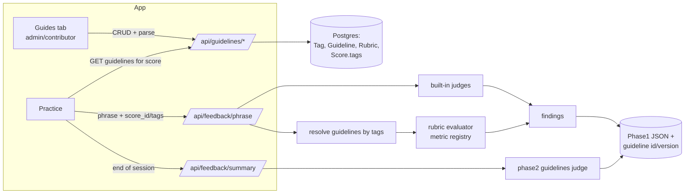

# Implementation Plan: Guideline & Rubric Editor

Status: implemented (Oct 26, 2026). See CHANGES.md for what is not done.

## Problem statement
Practice-hub feedback text and checks are hard-coded (`backend/practice_hub/feedback_generator/judges/feedbacks.py`, `summarizer.py`), and era feedback is an empty stub (`judges/phase2/era.py`). Admins and verified contributors need to author guidelines/tutorials attached to tags (e.g. `baroque`, `bach`, `fugue`), each with optional measurable rubrics (e.g. "gaps between the notes more than 0.5 sec") that the engine checks against each performance. Players see the tutorial before playing and the rubric results after.

## Requirements
1. Guidelines are an additional layer; built-in phase-1 judges, `OVERALL_WEIGHTS` and the `overall` score are unchanged.
2. Only admins (`is_staff`) and verified contributors (Django Group `guideline_contributor`) can author; enforced server-side. The model carries `owner` and `visibility` (public|private|shared) so per-user/shared authoring can be added later; only `public` is used now.
3. Rubrics are structured (metric, operator, value/value_max, unit, applies_to, pass_rate, severity, messages). A deterministic keyword-vocabulary parser turns author text into a structured rule for confirmation, behind a `RubricTranslator` interface so an LLM translator can be added later.
4. Matching is by tags: a guideline applies when ANY of its tags matches the piece's tags. A piece's era tag is derived automatically from `composed_date` using `parse_composed_year` + `era_for_year`.
5. Players see: a "How to play" card before practice, rubric findings per phrase in `PhraseFeedbackPill`, and guideline results in a new end-of-session summary.
6. The editor is a separate in-app tab, shown only to admin/contributor roles. The server enforces permissions regardless of UI.

## Design

- **Data model** (Django app `guidelines`): `Tag(slug, kind)`, `Guideline(title, body, tags, status, owner, visibility, version, timestamps)`, `Rubric(guideline, label, source_text, metric, operator, value, value_max, unit, applies_to, pass_rate, severity, fail_message, suggestion, enabled)`. `Score` gains `composed_date` and `tags`.
- **Metric registry** (`feedback_generator/guidelines/metrics.py`): `note_gap`, `sounding_ratio`, `onset_deviation`, `volume_range`.
- **Units**: `ms`, `sec`, `pct_of_note`, `pct_of_beat`, `ratio`, `volume` — normalized per measurement.
- **Evaluator**: a rubric fails when passing/total < pass_rate; zero applicable units means null score and no finding. Findings are `category="guideline"` and never count towards `overall`.
- **Phase 2**: `judges/phase2/guidelines.py` aggregates guideline findings per rubric into `Guidelines.json`. Era builder stubs removed; detection kept.
- **Keyword parser**: vocabulary tables for metric, comparator, number, unit → `ParseResult{rule, matched_spans, unrecognised, translator}`.
- **Auth**: `can_author(user)` = `is_staff` or member of `guideline_contributor`; `author_required` decorator (401/403). `/api/auth/me` gains `roles`.
- **API**: `GET/POST /api/guidelines`, `GET/PUT/DELETE /api/guidelines/<id>`, `GET /api/guidelines/for-score/<id>`, `GET /api/guidelines/tags`, `POST /api/guidelines/rubrics/parse`, `PATCH /api/scores/<id>/tags`.

## Defaults (approved)
1. Guideline body is plain text (line breaks) for v1.
2. Guideline results don't affect `overall`.
3. Default `pass_rate` = 0.8.
4. Composition dates/tags start manual; no IMSLP backfill in this scope.

## Tasks
- [x] Task 1: Metric registry and rubric evaluator (pure Python)
- [x] Task 2: Guideline data model, admin and roles
- [x] Task 3: Score tags and era derivation
- [x] Task 4: Wire guidelines into phase 1
- [x] Task 5: Phase 2 guidelines judge
- [x] Task 6: Keyword-vocabulary rubric parser and parse endpoint
- [x] Task 7: Guideline API and roles in `/me`
- [x] Task 8: Player side — tags in phrases, findings in the pill, "How to play" card
- [x] Task 9: Player side — end-of-session summary
- [x] Task 10: Guides editor tab (role-gated)
- [x] Task 11: Docs and cleanup
